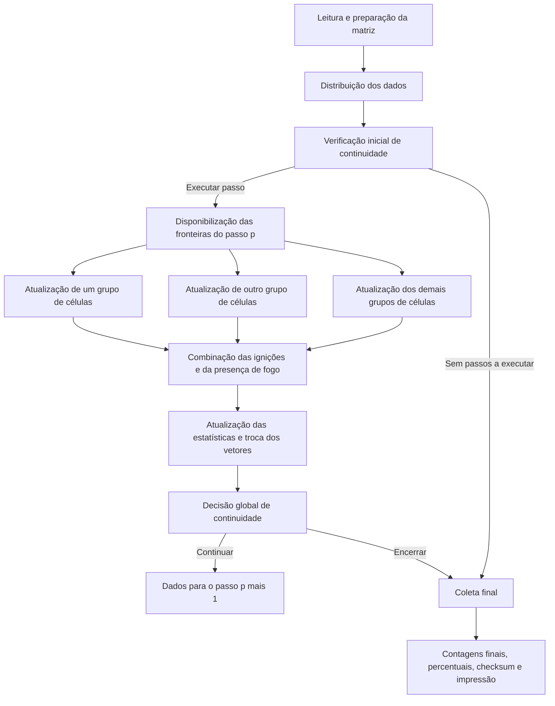

# PCAM — Simulação da propagação de incêndio

## Uma breve descrição do problema

Uma área florestal é representada por uma matriz de células. Cada célula possui cobertura, umidade, estado e tempo de queima. A partir de focos iniciais, o incêndio se propaga em passos, considerando os oito vizinhos de cada célula, a direção e a intensidade do vento, o combustível e a umidade. Zonas de contenção são ativadas em passos previamente definidos e protegem somente células ainda intactas.

A simulação termina quando não há células em chamas ou quando o limite de passos é atingido. Ao final, são apresentados as quantidades de células em cada estado, as estatísticas de ignição, os percentuais de área atingida e protegida, o checksum e o tempo do núcleo da simulação. A solução paralela deve preservar os resultados da versão sequencial para a mesma entrada.

## Particionamento (visa extrair tarefas e suas dependências)

O particionamento é por dados. Em cada passo, as células podem ser processadas em paralelo, pois o próximo estado de uma célula depende de seu próprio estado e dos estados dos vizinhos no passo atual. Os passos possuem uma dependência temporal: o passo seguinte precisa dos resultados do anterior.

Há uma tarefa responsável pela leitura da entrada e pela preparação da matriz. Ela gera a cobertura e a umidade na ordem exigida, aplica os focos iniciais e constrói o mapa de ativação das contenções, guardando o menor passo nas sobreposições. A geração pseudoaleatória é sequencial para preservar a sequência de chamadas a `rand_r`.

Conceitualmente, há uma tarefa para cada célula em cada passo. Essa tarefa verifica a ativação da contenção e calcula o próximo estado e o próximo tempo de queima. Para uma célula intacta sem contenção ativada, consulta os vizinhos em chamas e calcula o potencial de ignição. Para uma célula já em chamas, reduz o tempo de queima e verifica se ela passa ao estado queimada.

Cada tarefa lê os vetores atuais e escreve apenas nas posições correspondentes à sua célula nos vetores do próximo passo. Isso permite processar células vizinhas simultaneamente sem que uma leia resultados parcialmente atualizados da outra. Na implementação, a verificação da contenção é incorporada à atualização da própria célula. Essa organização preserva a regra de proteção, pois somente células em chamas contribuem para a ignição dos vizinhos, e a contenção atua somente sobre células intactas.

As tarefas também produzem informações sobre novas ignições e sobre a existência de fogo no próximo estado. Essas informações precisam ser combinadas antes de atualizar o total de ignições, registrar o pico e decidir se a simulação continua. Os vetores atuais e próximos são trocados depois que as atualizações terminam.

Após a simulação, uma tarefa reúne os estados e tempos finais, conta as células em cada estado, calcula os percentuais e o checksum e imprime a saída. O checksum percorre a matriz sequencialmente, na ordem linear exigida.

### Figura 1 — Grafo de dependências das tarefas

O grafo representa a preparação, um passo genérico e a finalização. Se houver continuidade, a mesma sequência de tarefas é executada para o passo seguinte. Se não houver fogo inicialmente, ou se o limite de passos for zero, nenhuma atualização é executada.

## Comunicação (visa identificar a comunicação e a sincronização entre as tarefas)

A tarefa de preparação fornece os parâmetros gerais a todos os participantes e distribui as partes da matriz. Na implementação MPI, o processo de rank 0 realiza essa preparação, envia os parâmetros por `MPI_Bcast` e distribui cobertura, umidade, ativação, estado e tempo de queima por `MPI_Scatterv`.

Durante a simulação, as tarefas precisam consultar os estados dos vizinhos. Quando as células pertencem ao mesmo processo, essa consulta é feita diretamente na memória local. Quando ficam em processos diferentes, é necessário comunicar os estados das linhas de fronteira. Como a matriz é dividida em faixas de linhas, cada processo com dados troca informações com, no máximo, os processos imediatamente acima e abaixo.

Cada faixa possui duas linhas extras de estado, chamadas linhas fantasma, para armazenar as fronteiras recebidas. São necessários apenas os estados dos vizinhos: cobertura, umidade e tempo de queima de uma célula vizinha não entram no cálculo do potencial da célula avaliada. A implementação usa duas chamadas bloqueantes a `MPI_Sendrecv` para a troca de fronteiras, antes da primeira atualização e depois de cada troca dos vetores.

Dentro de cada processo, as threads combinam suas novas ignições por uma redução de soma e a presença de fogo por uma redução de máximo. A barreira ao final do laço de atualização garante que essas informações e os próximos estados estejam prontos antes da etapa seguinte.

Entre processos, um `MPI_Allreduce` soma as novas ignições e os indicadores locais de presença de fogo. A soma dos indicadores informa se algum processo ainda possui células em chamas; ela não representa a quantidade de células em chamas. Todos recebem o mesmo resultado e tomam a mesma decisão de continuidade. Antes do primeiro passo, outro `MPI_Allreduce` verifica se existe fogo na configuração inicial.

A thread principal de cada processo realiza as chamadas MPI e troca os ponteiros dos vetores. Uma barreira OpenMP faz as demais threads aguardarem essa etapa e enxergarem os vetores e a condição de continuidade atualizados antes da próxima iteração. As reduções e a escrita exclusiva por célula dispensam o uso de regiões críticas ou operações atômicas nessa atualização.

Ao final, `MPI_Gatherv` reúne os estados e tempos de queima no rank 0, respeitando as posições originais da matriz. A contagem final dos estados, os percentuais, o checksum e a impressão são feitos nesse processo, fora do trecho cronometrado.

## Aglomeração (visa atribuir tarefas a processos, reduzindo sobrecargas)

A solução considera memória distribuída entre processos MPI e memória compartilhada entre as threads de cada processo. As tarefas por célula são agrupadas em faixas contíguas de linhas, aumentando a quantidade de trabalho realizada por processo e mantendo contíguos os dados enviados nas trocas de fronteira.

São utilizados os `NPrc` processos iniciados pelo `mpirun`. Cada um recebe `L / NPrc` linhas, com divisão inteira, e as linhas restantes são distribuídas, uma por processo, aos primeiros ranks. Dessa forma, as faixas diferem em no máximo uma linha. Se houver mais processos que linhas, alguns ficam sem células e continuam participando das operações coletivas.

Dentro de cada faixa, as células são distribuídas entre `T` threads com `omp for` e escalonamento estático. Cada thread processa um grupo de células, em vez de ser criada uma thread para cada célula. A região paralela permanece aberta durante o laço de passos, evitando a criação e o encerramento da equipe a cada passo. O laço também utiliza a diretiva `simd`.

Cada processo calcula suas estatísticas locais antes da comunicação global. As novas ignições e o indicador de fogo são agrupados em uma única redução MPI por passo. A comunicação das fronteiras também é agrupada por linha, em vez de ocorrer separadamente para cada célula.

O rank 0 acumula as tarefas de leitura, preparação e saída, mas também recebe uma faixa da matriz e participa da simulação. A divisão equilibra a quantidade de células atribuída aos participantes; o tempo de trabalho pode variar entre as faixas, pois o custo de atualização depende dos estados das células.

## Mapeamento (visa atribuir processos a elementos de processamento)

O mapeamento dos dados aos processos é estático: cada rank mantém a mesma faixa de linhas durante toda a simulação. Dentro de cada processo, o escalonamento OpenMP também é estático. A implementação não redistribui faixas entre processos conforme a frente de fogo avança.

Os processos são posicionados nos nós disponíveis pelo ambiente MPI, de acordo com o arquivo de hosts e as opções de execução. A alocação de processos por nó deve considerar os núcleos disponíveis e as `T` threads solicitadas por processo. Por exemplo, dois processos com quatro threads cada solicitam um total de oito threads de execução.

As threads são executadas nos núcleos sob o controle do ambiente OpenMP e do sistema operacional. O código não fixa explicitamente a afinidade dos processos ou das threads; o posicionamento físico depende das configurações de execução. O programa solicita suporte `MPI_THREAD_FUNNELED`, mantendo as chamadas MPI na thread principal de cada processo e usando as demais threads no processamento paralelo das células.

Essa organização associa faixas da floresta aos processos MPI e grupos de células às suas threads OpenMP. Para avaliar o mapeamento no ambiente experimental, devem ser comparadas diferentes combinações de processos e threads, registrando os recursos utilizados, os tempos e a preservação dos resultados da versão sequencial.
